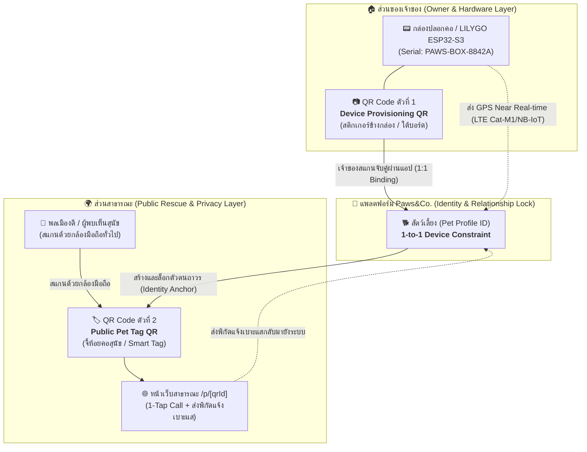
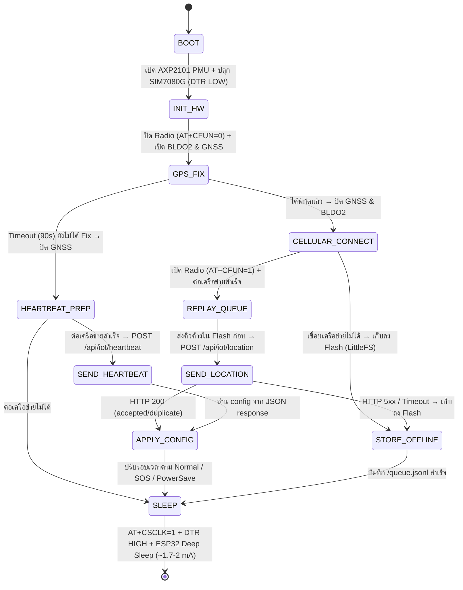
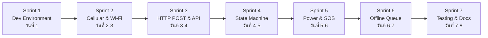
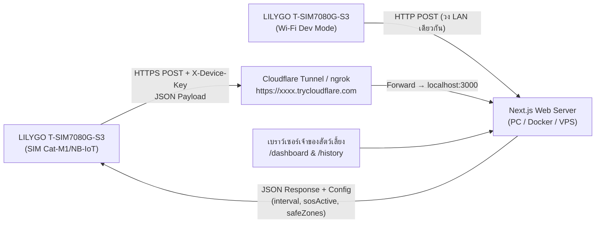

# 🐾 Paws&Co. — ระบบติดตามสุนัขแบบใกล้เคียงเวลาจริงผ่านเครือข่ายอินเทอร์เน็ต
### An Internet-based Near Real-time Dog Tracking System

[](https://nextjs.org/)
[](https://www.typescriptlang.org/)
[](https://tailwindcss.com/)
[](https://leafletjs.com/)
[](https://www.prisma.io/)
[](https://www.lilygo.cc/)

---

## 📖 บทนำและที่มาของโครงงาน (Project Overview)

ปัญหาการสูญหายของสัตว์เลี้ยงเป็นปัญหาที่พบได้บ่อยในปัจจุบัน โดยเฉพาะสุนัขที่หลุดออกจากที่พักอาศัย ซึ่งการติดตามมักทำได้ยากและอาศัยเพียงป้ายชื่อแบบเดิมหรือการประกาศหา โครงงานนี้จึงได้ออกแบบและพัฒนาระบบติดตามสุนัขแบบใกล้เคียงเวลาจริง (**Near Real-time Dog Tracking System**) 

ระบบผสานการทำงานร่วมกันระหว่าง:
1. **ฮาร์ดแวร์ปลอกคออัจฉริยะ (IoT Collar)**: บอร์ด **LILYGO T-SIM7080G-S3 ESP32-S3** รับสัญญาณดาวเทียม GNSS/GPS และส่งข้อมูลพิกัดผ่านเครือข่ายเซลลูลาร์ Cat-M / NB-IoT
2. **ระบบเว็บแอปพลิเคชัน (Paws&Co. WebApp)**: แพลตฟอร์มมอนิเตอร์พิกัดสดแบบเรียลไทม์ กำหนดเขตพื้นที่ปลอดภัย (Safe Zones / Geofence) แจ้งเตือนฉุกเฉิน และวิเคราะห์เส้นทางย้อนหลัง
3. **ป้ายชื่อดิจิทัล (Digital QR Code Tag)**: ป้าย QR ติดปลอกคอที่ให้ผู้พบสุนัขสามารถสแกนเพื่อโทรติดต่อเจ้าของได้ทันที 1-Tap โดยปกป้องความเป็นส่วนตัวไม่เปิดเผยพิกัดบ้าน

---

## 🛠️ ฮาร์ดแวร์ประจำโครงงาน (Hardware Architecture)

โครงงานนี้เลือกใช้บอร์ดทดลองประสิทธิภาพสูงที่ออกแบบมาสำหรับงาน IoT และการสื่อสารระยะไกลโดยเฉพาะ:

### 📟 บอร์ดทดลอง: **LILYGO T-SIM7080G-S3 ESP32-S3**
- **Microcontroller**: ชิปประมวลผล **ESP32-S3 Dual-Core Xtensa LX7**, 240 MHz
- **Memory**: **Flash 16MB**, **PSRAM 8MB** รองรับการประมวลผลอัลกอริทึมพิกัดและการเชื่อมต่อเครือข่ายที่ซับซ้อน
- **Cellular Modem**: **SIM7080G** รองรับคลื่นความถี่ **LTE Cat-M1** และ **NB-IoT** ครอบคลุมพื้นที่ทั่วประเทศไทย
- **GNSS / GPS**: ตัวรับสัญญาณดาวเทียมความแม่นยำสูง (GPS, GLONASS, BeiDou, Galileo)
- **Power Management (PMU)**: วงจรบริหารจัดการพลังงานอัจฉริยะในตัว รองรับ Sleep Mode และตรวจสอบระดับแรงดันแบตเตอรี่ (Battery Voltage / Level)
- **Battery**: แบตเตอรี่ Li-Po 3.7V ความจุ 1,000 mAh น้ำหนักเบา ปลอดภัยต่อสัตว์เลี้ยง ชาร์จผ่านพอร์ต Type-C
- **Status Indication**: ไฟแสดงสถานะ **WS2812B RGB Smart LED** (บอกสถานะ GPS Fix, การส่งสัญญาณ, และไฟค้นหากลางคืน)
- **Enclosure**: กล่องเคสกันน้ำกันฝุ่นมาตรฐาน **IP67** สำหรับสวมใส่กับปลอกคอสุนัข

### ⚡ สถาปัตยกรรมการทำงานและจัดการพลังงานของบอร์ด (Firmware & Power Optimization Architecture)

เนื่องจากอุปกรณ์ปลอกคอสุนัขมีข้อจำกัดด้านขนาดและน้ำหนักของแบตเตอรี่ (Li-Po 1,000 mAh) และชิปโมเด็ม **SIMCOM SIM7080G** มีคุณลักษณะทางฮาร์ดแวร์ที่ไม่สามารถเปิดรับสัญญาณดาวเทียม GNSS พร้อมกับส่งข้อมูลเซลลูลาร์ LTE Cat-M1/NB-IoT ในเวลาเดียวกันได้ ระบบจึงถูกออกแบบด้วยหลักการวิศวกรรม IoT สากล:

#### 1. วงจรการทำงานแบบสลับสถานะ (Time-Sharing State Machine Cycle)
เฟิร์มแวร์ C++/Arduino บน ESP32-S3 จะทำงานวนลูปแบบ 3 จังหวะ:
```
[ จังหวะ 1: GNSS Fix ] ──► ดึงพิกัดดาวเทียม (2-5 วินาที) ➔ ปิด/พัก GNSS
         │
[ จังหวะ 2: Cellular ] ──► เปิดเน็ต 4G ยิง HTTP POST เข้า Web API ➔ ปิดโมเด็ม
         │
[ จังหวะ 3: Low-Power ] ──► เข้า Deep Sleep เซฟแบตเตอรี่ (เหลือ ~1-2 mA) ➔ วนกลับจังหวะ 1
```

#### 2. กลยุทธ์การเพิ่มประสิทธิภาพและประหยัดพลังงาน (Key Engineering Strategies)
- **A-GPS (Assisted GPS)**: โหลดข้อมูลวงโคจรดาวเทียมล่วงหน้าผ่านอินเทอร์เน็ตเซลลูลาร์ ช่วยลดเวลาการค้นหาดาวเทียมจากเดิม 30–60 วินาที เหลือเพียง **2–5 วินาที** (Hot/Warm Fix)
- **Dual Operating Modes**:
  - **Normal Mode (สุนัขอยู่ในพื้นที่ปลอดภัย)**: อัปเดตพิกัดทุก 1–5 นาที เพื่อยืดอายุการใช้งานแบตเตอรี่ได้นานหลายวัน
  - **SOS / Emergency Mode (สุนัขพลัดหลง)**: เร่งรอบการอัปเดตเป็นทุกๆ **5–10 วินาที** เพื่อให้เจ้าของติดตามเส้นทางได้ใกล้เคียงเวลาจริงมากที่สุด
- **Offline Store-and-Forward Pattern**: หากเผชิญจุดอับสัญญาณเซลลูลาร์ บอร์ดจะบันทึกพิกัดสำรองลงใน Flash Memory (LittleFS) หรือ MicroSD Card ภายในบอร์ดไว้ชั่วคราว และทยอยส่งขึ้นระบบทันทีเมื่อสัญญาณกลับมา เพื่อไม่ให้ประวัติเส้นทางสูญหาย
- **ข้อได้เปรียบทางวิศวกรรม**: การสลับวงจรแบบ Time-Sharing ช่วยลดอัตราการสิ้นเปลืองพลังงานได้มากกว่าการเปิดโมดูลค้างไว้ถึง 70–80% และป้องกันไม่ให้อุปกรณ์สะสมความร้อนจนเป็นอันตรายต่อสัตว์เลี้ยง

---

## 🏷️ สถาปัตยกรรมระบบระบุตัวตนแบบ 2 QR Code (Dual QR Code Architecture)

โครงงาน Paws&Co. ได้รับการออกแบบเชิงสถาปัตยกรรมความปลอดภัยและการใช้งานจริงด้วย **ระบบ 2 QR Code (Dual QR Architecture)** ซึ่งเป็นมาตรฐานอุตสาหกรรมสำหรับอุปกรณ์ระบุตำแหน่งสัตว์เลี้ยงอัจฉริยะ (เช่นเดียวกับแพลตฟอร์มชั้นนำระดับโลก เช่น Apple AirTag, Tractive GPS, และ Fi Smart Collar) เพื่อแยกหน้าที่ระหว่าง **"การควบคุมฮาร์ดแวร์โดยเจ้าของ"** และ **"การช่วยเหลือสุนัขพลัดหลงโดยบุคคลทั่วไป"**:



### 1. 📦 QR Code ตัวที่ 1: Device Provisioning / Box Binding QR (สแกนผูกกล่อง 1:1)
- **ตำแหน่งติดตั้ง**: พิมพ์เป็นสติกเกอร์ติดข้างกล่องบรรจุภัณฑ์ หรือสลักไว้ใต้เคสกันน้ำของอุปกรณ์ LILYGO
- **ข้อมูลภายใน QR**: บรรจุข้อมูลประจำตัวของฮาร์ดแวร์ เช่น `PAWS-BOX-8842A` หรือ `LILYGO-S3-7080-8842A` (พร้อม Mac Address หรือ Provisioning Token)
- **หน้าที่หลัก**:
  - **บังคับสิทธิ์ความเป็นเจ้าของ (Device Ownership Claiming)**: เจ้าของเปิดแอป Paws&Co. เข้าเมนู *"เพิ่มสัตว์เลี้ยง"* แล้วใช้กล้องในแอปสแกน QR ข้างกล่องเพื่อจับคู่ (`QrBoxScannerDialog`)
  - **1 Pet : 1 Collar Binding**: บังคับกฎความสัมพันธ์ในระดับฐานข้อมูลแบบ `1-to-1` (`deviceId String? @unique` ใน Prisma Schema) เพื่อป้องกันไม่ให้อุปกรณ์ถูกแย่งไปจับคู่ซ้ำ หรือสัตว์หลายตัวดึงพิกัดจากกล่องเดียวกัน
  - **Telemetry Routing**: เมื่อบอร์ดฮาร์ดแวร์ส่งข้อมูลพิกัดดาวเทียมมาที่ `/api/iot/location` ระบบจะค้นหา `getPetByDeviceId(deviceId)` และอัปเดตเส้นทางให้สุนัขตัวนั้นโดยอัตโนมัติ

### 2. 🏷️ QR Code ตัวที่ 2: Public Smart Pet Tag QR (จี้ห้อยคอล็อกตัวตนประจำตัวสุนัข)
- **ตำแหน่งติดตั้ง**: พิมพ์ติดบนจี้ห้อยคอสุนัข (Smart Collar Tag) หรือพิมพ์เป็นการ์ดประจำตัวสุนัข (Pet ID Card)
- **ข้อมูลภายใน QR**: บรรจุ Universal Web URL สากล เช่น `https://pawsandco.app/p/QR-MOCHI-7749`
- **หน้าที่หลัก**:
  - **Identity Anchor (กุญแจล็อกตัวตน)**: ล็อกค่า `qrCodeId` เข้ากับโปรไฟล์ของสุนัขตัวนั้นอย่างถาวร
  - **Zero-Barrier Public Access**: หากสุนัขพลัดหลง พลเมืองดีที่เดินผ่านมา **ไม่จำเป็นต้องติดตั้งแอปพลิเคชันใดๆ** เพียงใช้กล้องมือถือ (iOS หรือ Android) สแกนที่จี้ห้อยคอ หน้าโปรไฟล์ฉุกเฉินจะเปิดขึ้นมาบนเบราว์เซอร์ทันที
  - **Privacy-First Shielding**: หน้าเว็บสาธารณะจะแสดงเฉพาะข้อมูลสำคัญที่จำเป็นต่อการช่วยเหลือ (รูปสุนัข, ชื่อ, สายพันธุ์, ข้อควรระวังด้านสุขภาพ/แพ้ยา, รางวัลน้ำใจ) พร้อมปุ่ม **"โทรหาเจ้าของ (1-Tap Call)"** โดย **ปกปิดพิกัดบ้านและระบบควบคุมหลังบ้าน** อย่างเข้มงวด
  - **Crowdsourced Sighting Report**: ผู้พบเห็นสามารถกดส่งตำแหน่ง GPS ปัจจุบันที่พบสุนัข พร้อมข้อความและเบอร์ติดต่อกลับ เพื่อแจ้งเตือนเจ้าของได้ทันที

---

## 🚀 สรุปผลงานที่พัฒนาเสร็จสมบูรณ์ใน Phase 1 (WebApp Phase)

ทีมพัฒนาได้ดำเนินการพัฒนาส่วน **Phase 1: Web Application** ครบถ้วน 100% ตามข้อกำหนด พร้อมระบบจำลองข้อมูลเสมือนจริง (**Demo Mode**) ที่รองรับการต่อยอดเชื่อมโยงกับฮาร์ดแวร์จริงใน Phase 2:

### 1. หน้าเว็บครบทั้ง 16 หน้า (16 Fully Functional Pages):
1. **🏠 [Landing Page](src/app/page.tsx) (`/`)**:
   - ออกแบบเมนูด้านบนเป็น **Floating Capsule Pill Island Navbar** สไตล์โมเดิร์น
   - ส่วน Hero พร้อมระบบจำลอง **Interactive Live Telemetry Simulator** สลับดูสุนัข "โมจิ (Golden)" / "ลัคกี้ (Shiba)" ได้ทันที
   - แสดงตัวเลขประสิทธิภาพ (Proof Metrics), ฟีเจอร์ Bento Grid 4 จุดเด่น, สเปกฮาร์ดแวร์ LILYGO ESP32-S3, และกล่องคำถามพบบ่อย (FAQ Accordion)
2. **🔐 [Authentication Page](src/app/auth/page.tsx) (`/auth`)**:
   - หน้า Login และ Register แบบสลับแท็บ พร้อมระบบ Zod Validation
   - ฟังก์ชันเปิด/ปิดดูรหัสผ่าน (Password Eye Toggle)
   - การ์ดเข้าสู่ระบบด่วน 1-Click สำหรับ **Demo User** (สมชาย ใจดี) และ **Demo Admin** (ผู้ดูแลระบบ)
3. **🛰️ [Live Tracking Dashboard](src/app/(app)/dashboard/page.tsx) (`/dashboard`)**:
   - แผนที่แสดงตำแหน่งสุนัขสด (Interactive Leaflet Map) พร้อม Marker ภาพถ่ายน้องหมา และวงแหวนเรดาร์
   - แสดงวงกลมขอบเขตพื้นที่ปลอดภัย (Safe Zone Geofences)
   - การ์ดข้อมูล Telemetry: แบตเตอรี่, ระดับสัญญาณ, ความเร็ว, สวิตช์ประหยัดพลังงาน, และปุ่ม **SOS Emergency Broadcast**
4. **🐕 [My Pets](src/app/(app)/pets/page.tsx) (`/pets`)**:
   - หน้ารายการสุนัขทั้งหมดในรูปแบบการ์ด พร้อมแถบสถานะแบตเตอรี่, สัญญาณ, สวิตช์เปิด/ปิด Battery Saver & Pro Alerts
5. **➕ [Add Pet Form](src/app/(app)/pets/new/page.tsx) (`/pets/new`)**:
   - ฟอร์มลงทะเบียนสุนัขพร้อมระบบเลือกรูปภาพโปรไฟล์ (2-5 รูป), เลือกรูปภาพหลัก, และระบบจำลองเชื่อมต่อบอร์ด LILYGO ESP32-S3
6. **📋 [Pet Details](src/app/(app)/pet/[id]/page.tsx) (`/pet/[id]`)**:
   - แกลเลอรีรูปภาพ Lightbox, ข้อมูลสุขภาพ, ตารางประวัติวัคซีน (เพิ่ม/แก้ไขได้), ระบบจัดการพื้นที่ปลอดภัย, ข้อมูลชิป IoT และปุ่มลบข้อมูล
7. **📈 [Location History](src/app/(app)/history/page.tsx) (`/history`)**:
   - แสดงเส้นทางการเดินย้อนหลังบนแผนที่ (Route Polyline), เหตุการณ์ไทม์ไลน์, ระยะทางรวม (km), เวลาที่ใช้, ความเร็วเฉลี่ย, และการใช้พลังงาน
8. **⚙️ [Settings](src/app/(app)/settings/page.tsx) (`/settings`)**:
   - แก้ไขโปรไฟล์ผู้ใช้, ตั้งค่าแจ้งเตือน (Zone Exit / Low Battery / Device Offline), สลับภาษาไทย 🇹🇭 / English 🇬🇧 ได้ทันทีทั้งระบบ
9. **📡 [Hardware Management](src/app/(app)/hardware/page.tsx) (`/hardware`)**:
   - ข้อมูลสเปกทางเทคนิคของบอร์ด LILYGO T-SIM7080G-S3 ESP32-S3, รายการอุปกรณ์ที่ลงทะเบียน, และ Wizard จับคู่อุปกรณ์ใหม่
10. **🏷️ [Public Pet Profile](src/app/p/[qrId]/page.tsx) (`/p/[qrId]`)**:
    - หน้าที่เปิดเมื่อสแกน QR Tag บนปลอกคอ — แสดงรูป ชื่อ เบอร์โทรติดต่อเจ้าของ, ปุ่มโทรออกได้ทันที (`tel:`), และฟอร์มแจ้งเบาะแสการพบ (**ไม่เปิดเผยพิกัดสดหรือข้อมูลส่วนตัวที่อ่อนไหว**)
11. **🛡️ [Admin Dashboard](src/app/(app)/admin/page.tsx) (`/admin`)**:
    - สถิติภาพรวม Users, Pets, Devices, Active Telemetry และตารางตรวจสอบความพร้อมของระบบ (System Health Check)
12. **📦 [Fleet ERP & Telematics Analytics](src/app/(app)/erp/page.tsx) (`/erp`)**:
    - **ระบบบริหารจัดการทรัพยากรฮาร์ดแวร์และวิเคราะห์ข้อมูลหลังบ้าน (Enterprise Resource Planning & IoT Fleet Analytics)**
    - ตรวจสอบสถานะสต็อกฮาร์ดแวร์ล็อตการผลิต (Batch Provisioning & Serial/IMEI Tracking)
    - วิเคราะห์อัตราการเสื่อมของแบตเตอรี่ (Battery Degradation %), อัตราหลุดขอบเขต (Geofence Breach Rate), และความเร็วในการจับสัญญาณดาวเทียม (TTFF)
    - บริหารจัดการแพ็กเกจซิมเซลลูลาร์ IoT (AIS NB-IoT, True IoT, DTAC Cat-M1) และปริมาณดาต้า (MB/month)
    - คำนวณต้นทุนต่อหน่วยโครงสร้างอุตสาหกรรม (Bill of Materials - BOM Breakdown) และระบบ Export ตารางวิเคราะห์ข้อมูลเป็น CSV
13. **🗺️ [Backoffice: ติดตามการเคลื่อนไหว](src/app/(app)/backoffice/movement/page.tsx) (`/backoffice/movement`)**:
    - มอนิเตอร์ตำแหน่งการเคลื่อนไหวของสุนัขและปลอกคอทุกตัวพร้อมกันบนแผนที่ดาวเทียม Leaflet
    - ระบบจำลองการเคลื่อนไหวสด (Live Telemetry Simulator) ตรวจสอบความเร็ว (km/h), ทิศทาง, เส้นทางย้อนหลัง (Breadcrumbs), และสถานะใน/นอกเขตปลอดภัย
14. **📋 [Backoffice: ข้อมูลอุปกรณ์และสเปก](src/app/(app)/backoffice/data/page.tsx) (`/backoffice/data`)**:
    - ฐานข้อมูลฮาร์ดแวร์รายเครื่อง (Master Device Registry): Serial Number, Box Code QR, IMEI, MAC Address, ค่ายซิม (AIS / True / DTAC), สุขภาพแบตเตอรี่ และสตรีมดูโค้ด JSON Telemetry สด พร้อมส่งออก CSV
15. **🚨 [Backoffice: การแจ้งปัญหาและงานซ่อม](src/app/(app)/backoffice/issues/page.tsx) (`/backoffice/issues`)**:
    - ระบบจัดการข้อร้องเรียนและงานซ่อมบำรุงฮาร์ดแวร์ (Issue Reporting & Ticket Dispatch): แบตเตอรี่เสื่อม, สัญญาณเน็ตหลุด, เคสแตกร้าว, หรือสุนัขพลัดหลง
    - ฟังก์ชันเปิดเคสใหม่ (+ Create Ticket), เปลี่ยนสถานะงานซ่อม (Open, In Progress, Resolved), มอบหมายช่าง และบันทึกประวัติการเปลี่ยนอะไหล่ RMA
16. **📈 [Backoffice: ดูการใช้งานและสถิติ](src/app/(app)/backoffice/usage/page.tsx) (`/backoffice/usage`)**:
    - วิเคราะห์พฤติกรรมการใช้งานเชิงลึก: กราฟระยะทางสะสมรายวัน (km/day), ชั่วโมงการเปิดเครื่องใช้งาน, ปริมาณการใช้ดาต้าซิมรายค่าย, อัตราการเสื่อมของแบตเตอรี่ (Battery Degradation Index), และตารางอันดับสุนัขที่มีกิจกรรมมากที่สุด (Top Active Dogs)

---

### 2. ระบบ API ทั้งหมด 19 HTTP Endpoints:
```
Authentication:
  POST   /api/auth/login          — ตรวจสอบสิทธิ์และสร้าง JWT Cookie
  POST   /api/auth/signup         — ลงทะเบียนผู้ใช้ใหม่
  POST   /api/auth/logout         — ล้างเซสชัน Cookie
  GET    /api/auth/me             — ตรวจสอบเซสชันผู้ใช้ปัจจุบัน

Pets Management:
  GET    /api/pets                — ดึงรายการสัตว์เลี้ยงทั้งหมดของผู้ใช้
  POST   /api/pets                — เพิ่มสัตว์เลี้ยงใหม่
  GET    /api/pets/[id]           — ดึงข้อมูลสัตว์เลี้ยงรายตัว
  PUT    /api/pets/[id]           — แก้ไขข้อมูลสัตว์เลี้ยง
  DELETE /api/pets/[id]           — ลบสัตว์เลี้ยง
  GET    /api/pets/[id]/history   — ดึงประวัติพิกัด GPS ย้อนหลัง

User Profile:
  GET    /api/user                — ดึงข้อมูลโปรไฟล์ผู้ใช้
  PUT    /api/user                — แก้ไขข้อมูลโปรไฟล์

IoT Telemetry & Device (Hardware-ready REST v1):
  POST   /api/iot/location        — รับและตรวจสอบ GPS Telemetry พร้อม idempotency
  POST   /api/iot/heartbeat       — อัปเดตสถานะบอร์ดเมื่อ GNSS ยังไม่มี Fix
  GET/PUT /api/iot/config         — อ่าน/ตั้งค่ารอบส่งข้อมูล Power Save และ SOS

Public QR Tag:
  GET    /api/pet/[qrId]          — ข้อมูลโปรไฟล์สาธารณะสำหรับผู้สแกน QR
  POST   /api/pet/[qrId]/report   — ส่งรายงานแจ้งเบาะแสเมื่อพบสัตว์เลี้ยง

System:
  GET    /api/health              — ตรวจสอบสถานะการทำงานของระบบ (Uptime & Services)
```

### Hardware Integration Readiness — 10 กันยายน 2569

- ✅ Device authentication แยก key ต่อบอร์ดผ่าน `X-Device-Key`
- ✅ ตรวจช่วงค่าพิกัด แบตเตอรี่ สัญญาณ ความเร็ว ทิศทาง และสถานะ GNSS
- ✅ รองรับ `messageId` เพื่อไม่บันทึกข้อมูลซ้ำเมื่อ Cat-M/NB-IoT retry
- ✅ Heartbeat สำหรับกรณีบอร์ดออนไลน์แต่ยังจับดาวเทียมไม่ได้
- ✅ ส่ง `updateIntervalSeconds`, Power Save และ SOS กลับไปให้ firmware
- ✅ ส่ง Safe Zones ให้บอร์ดและคำนวณ `ENTERED_ZONE`/`LEFT_ZONE` ฝั่ง server
- ✅ Dashboard polling ทุก 10 วินาที และ History polling ทุก 15 วินาที
- ✅ Smoke test ครอบคลุมเส้นทางจากอุปกรณ์ถึง Dashboard/History
- ✅ เก็บ Telemetry local แบบ JSONL และโหลดคืนได้หลังรีสตาร์ต server

รายละเอียด payload, response และ retry policy อยู่ที่ [`docs/IOT_API.md`](docs/IOT_API.md)

---

### 3. โครงสร้างฐานข้อมูล Prisma Database Schema (`prisma/schema.prisma`):
ออกแบบ 9 โมเดลสัมพันธ์รองรับฐานข้อมูล PostgreSQL:
1. `User` — ข้อมูลผู้ใช้งานและบทบาท (USER / ADMIN)
2. `Pet` — ข้อมูลสุนัข (ชื่อ สายพันธุ์ อายุ น้ำหนัก รูปภาพ รหัส QR Tag)
3. `PetPhoto` — แกลเลอรีรูปภาพสุนัข (2-5 รูป)
4. `Device` — ข้อมูลฮาร์ดแวร์ LILYGO ESP32-S3 (IMEI, MAC, แบตเตอรี่, สถานะ)
5. `SafeZone` — ขอบเขตพื้นที่ปลอดภัยและรัศมี (พิกัด ละติจูด/ลองจิจูด, รัศมีเป็นเมตร)
6. `LocationHistory` — บันทึกประวัติการส่งพิกัดดาวเทียมย้อนหลัง
7. `Alert` — ประวัติการแจ้งเตือน (เตือนออกนอกเขต, แบตเตอรี่ต่ำ, SOS)
8. `Vaccination` — บันทึกประวัติการฉีดวัคซีนของสุนัข
9. `PublicPetProfile` — ข้อมูลสำหรับหน้าสแกน QR Code เพื่อความปลอดภัย

---

## ⚡ วิธีการติดตั้งและเปิดใช้งาน (Quick Start)

### 1. รันโหมด Development (Node.js)
```powershell
cd d:\Petgugu\petgugu
npm install
npm run dev
```
เปิดเบราว์เซอร์ไปที่: **`http://localhost:3000`**

### 2. รันโหมด Production ด้วย Docker 🐳
โปรเจกต์รองรับการ Deploy ผ่าน Docker ด้วย Next.js Standalone Image ขนาดกะทัดรัด (เพียง **54.9 MB**):

```powershell
# รันเฉพาะแอปพลิเคชันเดี่ยวผ่าน Docker CLI
docker run -d -p 3000:3000 --name pawsandco-app pawsandco:latest

# หรือรันทั้งระบบพร้อมฐานข้อมูล PostgreSQL ผ่าน Docker Compose
cd d:\Petgugu\petgugu
docker compose up -d
```

### 3. บัญชีทดสอบสำหรับ Demo Mode
- 🐶 **ผู้ใช้งานทั่วไป (Pet Owner)**: `demo@pawsandco.com` | รหัสผ่าน: `demo1234`
- 🛡️ **ผู้ดูแลระบบ (Admin)**: `admin@pawsandco.com` | รหัสผ่าน: `admin1234`
*(สามารถคลิกการ์ด Quick Demo บนหน้า Login เพื่อเข้าสู่ระบบได้ทันทีโดยไม่ต้องพิมพ์)*

### 4. คำแนะนำการทดสอบด้วย Docker (Demo Mode vs Clean Slate Testing)
- **ควรลบข้อมูล Demo ก่อนเปิด Docker หรือไม่?**:
  - **ช่วงเริ่มต้น (แนะนำ): "ยังไม่ควรลบข้อมูล Demo ออก"** 
    - ข้อมูลจำลอง (เช่น Mochi และ Lucky) ช่วยทำหน้าที่เป็น **Smoke Test Data** ให้คุณตรวจสอบได้ทันทีหลังคอนเทนเนอร์บิลด์เสร็จว่า หน้าแผนที่ Leaflet, ประวัติเส้นทางย้อนหลัง, กราฟสถิติ, และ Layout ทำงานได้อย่างราบรื่นใน Docker Environment
    - หากล้างข้อมูลตั้งแต่แรก หน้าต่างทั้งหมดจะเข้าสู่ Empty State (ว่างเปล่า) ทำให้ตรวจสอบความสมบูรณ์ของการเรนเดอร์ได้ยาก
  - **การทดสอบเชื่อมต่อฮาร์ดแวร์จริง**:
    - คุณสามารถกด **"+ เพิ่มสัตว์เลี้ยงใหม่"** และใช้กล้องสแกน QR กล่องฮาร์ดแวร์จริงของคุณเข้ามาได้เลย โดยระบบจะบันทึกอุปกรณ์จริงแยกจากข้อมูลตัวอย่างอย่างอิสระ
  - **เมื่อพร้อมล้างข้อมูลเพื่อขึ้นระบบจริง (Clean Slate)**:
    - สลับการทำงานจาก Demo Mode เป็นฐานข้อมูลจริง โดยปรับ Environment Variable ใน `docker-compose.yml`:
      ```yaml
      NEXT_PUBLIC_DEMO_MODE=false
      DATABASE_URL=postgresql://pawsandco:pawsandco@db:5432/pawsandco?schema=public
      ```
    - หรือลบไฟล์ `.runtime/demo-state.json` เพื่อรีเซ็ตสถานะข้อมูลทั้งหมดให้กลับสู่จุดเริ่มต้น

---

## 📅 บันทึกความคืบหน้าและการพัฒนาล่าสุด (Updates — 19 พฤศจิกายน 2569)

ในรอบการพัฒนานี้ ได้ดำเนินการยกระดับระบบให้พร้อมสมบูรณ์สำหรับการทดสอบระบบจริง (Field Test) และการประเมินผลโปรเจกต์จบ:

### 1. 🏷️ สถาปัตยกรรมระบบ 2 QR Code & การผูกอุปกรณ์ 1:1 (Dual QR Architecture)
- **QR Code ตัวที่ 1 (Device Provisioning / Box Binding)**: พัฒนาโมดอลสแกนรหัสกล่องปลอกคอ (`QrBoxScannerDialog`) รองรับการเปิดกล้องมือถือสแกนสติกเกอร์ข้างกล่องหรือพิมพ์รหัสกล่องด้วยตนเอง (เช่น `PAWS-BOX-8842A`) เพื่อผูกความสัมพันธ์กับสุนัขแบบ 1 ต่อ 1 (`deviceId String? @unique`)
- **QR Code ตัวที่ 2 (Public Smart Pet Tag)**: ออกแบบหน้าเว็บสาธารณะ `/p/[qrId]` สำหรับสแกนจี้ห้อยคอสุนัข รองรับการโทรหาเจ้าของทันที 1-Tap (`tel:...`) และฟอร์มแจ้งเบาะแสพิกัดสุนัขหลงทาง พร้อมระบบป้องกันความเป็นส่วนตัว (Privacy Shielding) ไม่เปิดเผยพิกัดบ้าน

### 2. 📱 ระบบจัดรูปแบบเบอร์โทรศัพท์อัตโนมัติขณะพิมพ์ (Smart Real-time Phone Auto-Formatting)
- พัฒนาฟังก์ชัน `formatPhoneInput` ใน `@/lib/utils` จัดกลุ่มตัวเลขพร้อมใส่ขีดคั่น (`-`) แบบเรียลไทม์ขณะที่ผู้ใช้พิมพ์
- รองรับรูปแบบตัวเลขหลากหลายตามการใช้งานจริง:
  - **รูปแบบ 11 หลัก**: เช่น `0123-444-4444` (จัดกลุ่ม 4-3-4 ตามตัวอย่างสากล)
  - **เบอร์มือถือไทย 10 หลัก**: เช่น `081-234-5678` หรือ `09X-XXX-XXXX` (จัดกลุ่ม 3-3-4)
  - **เบอร์บ้าน 9 หลัก**: เช่น `02-XXX-XXXX` (จัดกลุ่ม 2-3-4)
- บูรณาการไอคอนโทรศัพท์ 📞 และการจัดรูปแบบนี้เข้าสู่ทุกหน้าในระบบ:
  - หน้าสมัครสมาชิก (`/auth` - Register tab)
  - หน้าตั้งค่าโปรไฟล์ผู้ใช้ (`/settings`)
  - หน้าต่างแก้ไขข้อมูลสัตว์เลี้ยงและเบอร์โทรฉุกเฉิน (`EditPetDialog`)
  - หน้าต่างแจ้งเบาะแสของผู้พบเห็นสุนัข (`/p/[qrId]`)

### 3. 🎨 ปรับโฉมดีไซน์คำถามพบบ่อย (FAQ Rounded Pill Cards Redesign)
- ปรับปรุงการแสดงผลส่วนคำถามที่พบบ่อย (FAQ) บนหน้าแรก ให้เป็นการ์ดแคปซูลมนขอบลึก (`rounded-2xl sm:rounded-[22px]`) แยกแต่ละกล่องอย่างอิสระ
- ออกแบบบนพื้นหลังสีครีมสว่างนวลตา (`#F7F4EE`) ขับให้การ์ดสีขาวมีมิติลอยตัวอย่างนุ่มนวล พร้อมหัวลูกศรบรอนซ์มินิมอล (`text-[#8C6D46]`) และแอนิเมชันหมุน 180° เมื่อเปิดดูคำตอบ

### 4. ⚡ การยกระดับประสิทธิภาพและความเสถียร (Performance & Geofence Upgrades)
- **Safe Zone Range Slider**: พัฒนาระบบปรับตั้งค่ารัศมีพื้นที่ปลอดภัยแบบสไลเดอร์ (50 – 5,000 เมตร) พร้อมปุ่มลัด (Quick Chips: 50m, 100m, 300m, 500m, 1km, 2km) และคำนวณซูมแผนที่ `fitBounds` อัตโนมัติ
- **Mobile Photo Compressor**: ระบบเลือกรูปสัตว์เลี้ยงหลายรูปพร้อมกันจากคลังภาพหรือกล้องหลังมือถือ พร้อมบีบอัดรูปภาพฝั่งเบราว์เซอร์ (Client-side Canvas Compression) ป้องกัน memory leak
- **Context Memoization & SWR Fingerprinting**: ป้องกันปัญหาการเรนเดอร์ซ้ำซ้อนบนหน้า Dashboard และแผนที่ Leaflet
- **Mobile Responsive Layout**: จัดระเบียบหัวข้ออัปโหลดภาพสัตว์เลี้ยงบนจอมือถือขนาดเล็กให้ตัดคำและจัดแถวอย่างสวยงาม (`flex-col sm:flex-row`) ไม่ให้ Badge นับจำนวนรูปเบียดหรือตกหล่น

### 5. 📦 ระบบ ERP หลังบ้านและแดชบอร์ดตารางวิเคราะห์ (IoT Fleet ERP & Telematics Analytics)
พัฒนาหน้าระบบบริหารทรัพยากรฮาร์ดแวร์หลังบ้านแบบครบวงจร (`/erp`) พร้อมชุดข้อมูลจำลองมาตรฐานอุตสาหกรรม (`src/data/erp-data.ts`) สำหรับทีมปฏิบัติการและผู้ดูแลระบบ:
- **4 KPI สรุปภาพรวมระดับผู้บริหาร (Executive Overview Metrics)**:
  - **คลังอุปกรณ์ฮาร์ดแวร์**: 128 เครื่อง (ทำงานจริงในสนาม: 94 | สต็อกพร้อมใช้งาน: 26 | ซ่อมบำรุง/RMA: 8)
  - **สุนัขในความคุ้มครอง**: 94 ตัว (อัตรากู้คืนสำเร็จ 100%, เวลาช่วยเหลือเฉลี่ย 18.5 นาที)
  - **ปริมาณพิกัด Telemetry Pings**: 1,482,920 ครั้ง (ซิมแอ็กทีฟ: 102 ซิม, ปริมาณดาต้ารวม 4.35 GB)
  - **สุขภาพแบตเตอรี่ & ต้นทุน**: สุขภาพแบตเตอรี่เฉลี่ยทั้งฝูง 82.4% (ต้นทุนวัสดุเฉลี่ย BOM: ฿1,450 / เครื่อง)
- **4 แท็บตารางและการวิเคราะห์ข้อมูล (Interactive Tabbed Modules)**:
  1. 📦 **คลังและฝูงอุปกรณ์ (Hardware Fleet Table)**: ค้นหาตาม Serial, Box Code, IMEI, ชื่อสุนัข, เบอร์เจ้าของ พร้อมตัวกรองสถานะ (Active, Ready, Maintenance, Reserved) และตัวกรองค่ายซิม (AIS, True, DTAC) พร้อมโมดอลดูสเปกเชิงลึกและส่งเคลม RMA
  2. 📊 **แดชบอร์ดสถิติ & เหตุการณ์ (Incidents & Telemetry Analytics)**: บันทึกประวัติเหตุการณ์หลุดออกนอก Safe Zone, สัญญาณขาดหาย, แจ้งเตือนแบตเตอรี่ต่ำ และสถิติวิศวกรรม (TTFF 3.2s ด้วย A-GPS, Packet Loss <0.6%, Geofence Accuracy 99.4%)
  3. 📶 **เครือข่าย & ซิมการ์ด IoT (Cellular & SIM Fleet Management)**: วิเคราะห์แพ็กเกจซิมการ์ด AIS NB-IoT (62 ซิม), True IoT (28 ซิม), DTAC Cat-M1 (12 ซิม), ปริมาณดาต้าเฉลี่ยต่อเดือน และต้นทุนค่าบริการเครือข่าย
  4. 💰 **โครงสร้างต้นทุน BOM (Bill of Materials Breakdown)**: แจกแจงต้นทุนชิ้นส่วนอุตสาหกรรมรายชิ้น (ESP32-S3, SIM7080G, AXP2101 PMU, แบตเตอรี่ Li-Po, เคสกันน้ำ IP67, สายรัดปลอกคอ, จี้ QR Tag) รวม ฿1,450 / ชุด
- **ฟังก์ชันขึ้นทะเบียนล็อตการผลิตใหม่ (Batch Provisioning Modal)**: สร้างรหัส Serial Number, Box Code QR, แมปซิมการ์ด และคำนวณต้นทุนรวมอัตโนมัติ
- **ระบบส่งออกข้อมูล (Export to CSV)**: ดาวน์โหลดตารางข้อมูลฮาร์ดแวร์ทั้งหมดเป็นไฟล์ CSV ได้ทันทีเพียงคลิกเดียว

### 6. 🔬 ผลการวิจัยโครงการเทียบเคียงบน GitHub (GitHub Open-Source Benchmarks & Prior Art)
จากการสืบค้นและสำรวจ Repositories บน GitHub ที่พัฒนาระบบใกล้เคียงกัน พบแนวทางและสถาปัตยกรรมที่นำมาเทียบเคียงดังนี้:
1. **[Circuit-Digest/Smart-Pet-Tracker-System](https://github.com/Circuit-Digest/Smart-Pet-Tracker-System)**:
   - โครงการ IoT Pet Tracker บน ESP32 + SIM800L/A9G ส่งพิกัดขึ้นคลาวด์และแจ้งเตือนผ่าน SMS/HTTP มีจุดอ่อนคือใช้โมเด็ม 2G แบบเก่า และไม่มีระบบบริหารสต็อกฮาร์ดแวร์หลังบ้าน
2. **[Nicolanz/pet_tracker](https://github.com/Nicolanz/pet_tracker)**:
   - ระบบติดตามสัตว์เลี้ยงด้วย GPS Collar + Flask + PostgreSQL + Google Maps มีแผนที่และพิกัด แต่ขาดระบบ Safe Zone เชิงรุก และไม่มีหน้าเว็บสาธารณะสำหรับการสแกนจี้ QR
3. **[Traccar](https://github.com/traccar/traccar)** & **[OpenRemote](https://github.com/openremote/openremote)**:
   - แพลตฟอร์มมาตรฐานสากลด้าน IoT Telematics & Fleet Asset Management ที่มีความสามารถในการจัดการอุปกรณ์จำนวนมาก (Multi-device Provisioning), คำนวณ Geofence Event และเก็บประวัติ Telemetry ที่ Paws&Co. นำแนวคิดมาปรับใช้กับโมเดลสัตว์เลี้ยง
4. **[DianaFarhat29/PetCare-Tracker](https://github.com/DianaFarhat29/PetCare-Tracker)** & **[Sedefkjamili/PetopiaAnimalShelter](https://github.com/Sedefkjamili/PetopiaAnimalShelter)**:
   - ตัวอย่างระบบ ERP และบันทึกประวัติสัตว์เลี้ยง/ศูนย์พักพิงสัตว์ ที่เน้นเรื่องข้อมูลสุขภาพ ประวัติการรักษา และการดูแล แต่ไม่ได้เชื่อมต่อกับสัญญาณพิกัด GPS/IoT สด
5. **เกณฑ์มาตรฐานระดับอุตสาหกรรม (Commercial IoT Industry Benchmarks)**:
   - **Tractive GPS** & **Fi Smart Collar**: แบรนด์ระดับโลกที่ใช้โมเดลคล้ายคลึงกับ Paws&Co. คือมีทั้งฮาร์ดแวร์ปลอกคอ, การส่งข้อมูลผ่าน LTE-M/NB-IoT, ระบบหลังบ้านสำหรับ Provisioning อุปกรณ์ และหน้า Emergency Public Profile สำหรับผู้พบเห็นสุนัขสแกน QR Tag

---

## 📅 บันทึกความคืบหน้าและการพัฒนา (Updates — 18 พฤศจิกายน 2569)

ในรอบการพัฒนานี้ ได้ดำเนินการปรับปรุงและพัฒนาครอบคลุมทั้ง 4 ด้านหลักเพื่อเตรียมความพร้อมสำหรับโปรเจกต์จบ:

### 1. 🐳 Docker Packaging & Containerization
- **Next.js Standalone Mode**: ปรับแต่ง `next.config.mjs` เปิดใช้งาน `output: 'standalone'` เพื่อลดขนาด Dependencies ให้เหลือเฉพาะไฟล์ที่รันจริง
- **Production-grade Dockerfile**: สร้าง Multi-stage Dockerfile บนพื้นฐาน `node:20-alpine` พร้อมสิทธิ์ความปลอดภัย unprivileged user (`nextjs:nodejs`)
- **Ultra-lightweight Image**: คอมไพล์ได้ Image ขนาดบีบอัดเพียง **54.9 MB** (Disk usage 229 MB) บูตพร้อมให้บริการใน 108ms
- **Docker Images Generated**: บิลด์และแท็กสำเร็จเป็น `pawsandco:latest` และ `petgugu:latest` บน Docker Desktop
- **Docker Compose Orchestration**: ตั้งค่า `docker-compose.yml` รองรับการรันร่วมกับ PostgreSQL 16 Alpine Database พร้อม Healthcheck

### 2. 🎨 UI/UX Redesign & Human-centered Polish
- **Layout & Collision Fixes**: ปรับปรุงตำแหน่ง Floating Badges และ Toast Notifications ให้อยู่มุมซ้ายบนอย่างเป็นระเบียบ ไม่ทับซ้อนกับปุ่มควบคุมแผนที่และสถานะสด
- **Natural Tone of Voice**: ปรับลดคำที่ดูเป็น AI หรือประดิษฐ์เกินไป ให้เป็นภาษาไทยที่กระชับ อบอุ่น และเป็นธรรมชาติสำหรับเจ้าของสัตว์เลี้ยง
- **Public QR Pet Profile (`/p/[qrId]`)**:
  - ปรับดีไซน์หน้าสแกนปลอกคอดิจิทัลให้มุ่งเน้นการติดต่อเจ้าของทันที (1-Tap Call)
  - นำป้ายแท็ก `Tag ID` ออกตามคำขอ เพื่อให้หน้าจอคลีน สบายตา ไม่เกะกะสายตา
  - รองรับโหมดฉุกเฉินสุนัขพลัดหลง (SOS Lost Pet Mode) แสดงแถบเตือนสีแดงเด่นชัดและปุ่มโทรฉุกเฉิน

### 3. 📡 การทดสอบความพร้อมฝั่งฮาร์ดแวร์ IoT (Hardware Readiness)
- **REST Telemetry API Verification**: รัน Smoke Test (`scripts/iot-smoke-test.mjs`) ผ่านฉลุย 100% ครอบคลุม:
  - `POST /api/iot/location` — รับพิกัด GNSS พร้อมคำนวณ Safe Zone แบบ Real-time
  - `POST /api/iot/heartbeat` — บันทึกสถานะบอร์ด แบตเตอรี่ และสัญญาณแม้ยังไม่มีสัญญาณดาวเทียม
  - `GET /api/iot/config` — ซิงก์รอบเวลาส่งพิกัดและพารามิเตอร์ของโซนปลอดภัย
- **Device Authentication**: ระบบรักษาความปลอดภัยระดับฮาร์ดแวร์ด้วย Header `X-Device-Key` ประจำแต่ละบอร์ด และระบบ Idempotency ตรวจจับพิกัดซ้ำด้วย `messageId`
- **Firmware Inspection**: ตรวจสอบโค้ดเฟิร์มแวร์ทดสอบพิกัด GNSS บนบอร์ด `LILYGO T-SIM7080G-S3 ESP32-S3` ([PetguguGPS.ino](firmware/PetguguGPS/PetguguGPS.ino))

### 4. 🧠 สถาปัตยกรรมโปรเจกต์จบ (Capstone Architecture & Research)
- **การวิจัย UI/UX แผนที่ GPS ระดับสากล**: วิเคราะห์ข้อดีจากแพลตฟอร์มชั้นนำอย่าง **Tractive Web (`my.tractive.com`)**, **Apple Find My**, **Traccar**, และ **Life360**
- **Core Design Strategy**: ผสาน **Apple Find My (ความเรียบง่าย สบายตา บอกสถานที่ด้วยชื่อคุ้นเคย)** ร่วมกับ **Tractive (ความลึกของข้อมูล Telemetry และการแจ้งเตือน Safe Zone)**
- **Offline Store-and-Forward Logging**: ออกแบบแนวทางการเก็บ Log สำรองบนบอร์ด (LittleFS ใน Flash 16MB หรือ MicroSD Card) เมื่อหลุดจากสัญญาณ 4G/NB-IoT เพื่อให้ประวัติเส้นทาง (Location History) ต่อเนื่องไม่สูญหาย และเป็นจุดเด่นทางวิศวกรรมสำหรับนำเสนอ

---

## 🧪 ผลการตรวจสอบความถูกต้องของโค้ด (Quality Assurance)

| คำสั่งทดสอบ | ผลลัพธ์ | รายละเอียด |
|---|---|---|
| `npm run lint` | ✅ **Passed** | 0 warnings, 0 errors |
| `npx tsc --noEmit` | ✅ **Passed** | 0 type errors |
| `npm run build` | ✅ **Passed** | คอมไพล์หน้า Static & Dynamic ครบทั้ง 21 เส้นทาง |
| `npx prisma generate` | ✅ **Passed** | สร้าง Prisma Client สำหรับ 9 Data Models สมบูรณ์ |

---

## 🎓 การประเมินความพร้อมและแนวทางการนำเสนอสำหรับโปรเจกต์จบ (Capstone Evaluation & Defense Strategy)

ส่วนนี้สรุปการวิเคราะห์เชิงวิชาการสำหรับใช้เตรียมความพร้อมในการสอบโครงงานเทคโนโลยีสารสนเทศ/วิศวกรรมคอมพิวเตอร์ระดับปริญญาตรี เพื่อให้มั่นใจในคุณภาพและผลการประเมินระดับเกรด A+:

### 1. 📊 สรุปความพร้อมของระบบในภาพรวม (Current Readiness Assessment)

| หมวดหมู่การประเมิน | ความพร้อม | สถานะทางวิศวกรรม |
|---|:---:|---|
| **Web Application & UI/UX** | **100%** | ครบทั้ง 11 หน้าเว็บหลัก, Responsive Mobile-first, รองรับ 2 ภาษา (TH/EN), สลับธีมธรรมชาติ |
| **Backend Architecture & REST API** | **100%** | มี 19 API endpoints, รองรับ Token Auth, Idempotency (`messageId`), และ Healthcheck |
| **Database & Schema Modeling** | **100%** | ออกแบบ Prisma Schema 9 โมเดล รองรับ PostgreSQL บน Docker |
| **Identity & Security Architecture** | **100%** | สถาปัตยกรรม 2 QR Codes (ผูกกล่อง 1:1 + จี้ห้อยคอฉุกเฉิน Privacy-Safe Shielding) |
| **Data Input & Usability UX** | **100%** | Real-time Phone Auto-formatting (`0123-444-4444` / `081-234-5678`), Slider Safe Zone |
| **Live IoT Hardware Integration** | **In-Progress** | มีโค้ดอ่านพิกัด GNSS พร้อม และมีแผน Sprint สำหรับยิงเข้า Web API ใน Phase 2 |

---

### 2. 🏆 หัวใจสำคัญสู่คะแนนระดับเกรด A+ ในวันสอบจบ (Defense Strategy)

1. **การสาธิตระบบจริงตั้งแต่ต้นน้ำถึงปลายน้ำ (Live End-to-End Demonstration)**:
   - นำบอร์ด **LILYGO T-SIM7080G-S3** ส่งพิกัดจริงเข้าสู่เซิร์ฟเวอร์ และแสดงผลให้คณะกรรมการเห็นหมุดบนหน้า Dashboard ขยับตามจริง
   - **มาตรการลดความเสี่ยงวันสอบ**: จัดเตรียมเฟิร์มแวร์โหมดเชื่อมต่อผ่าน Wi-Fi สำรองไว้ด้วย เผื่อในห้องสอบเป็นจุดอับสัญญาณดาวเทียมหรือเซลลูลาร์
2. **ชิ้นงานจำลองฮาร์ดแวร์จริง (Physical Prototype)**:
   - ประกอบบอร์ดลงกล่องเคสปลอกคอ (3D Printed Case หรือกล่องกันน้ำ IP67) พร้อมติดสติกเกอร์ QR Code ตัวที่ 1 และแขวนจี้ห้อยคอ QR Code ตัวที่ 2 บนโต๊ะสอบ
3. **การเก็บผลการทดลองเชิงวิชาการสำหรับเล่มรายงาน (บทที่ 4: ผลการทดสอบและวิเคราะห์ผล)**:
   - คณะกรรมการจะพิจารณาความน่าเชื่อถือจาก **ตัวเลขผลการทดสอบเชิงประจักษ์ (Empirical Test Results)**:

| หัวข้อการทดสอบ (Test Parameter) | ระเบียบวิธีทดสอบ (Methodology) | เป้าหมายตัวเลขที่แนะนำสำหรับเล่มรายงาน |
|---|---|---|
| **ความแม่นยำของพิกัดดาวเทียม (GNSS Accuracy)** | วัดพิกัด 20 จุด ในพื้นที่โล่งและพื้นที่ชุมชน เทียบกับพิกัดจริงบน Google Maps | ความคลาดเคลื่อนเฉลี่ย **≤ 2.5 – 5.0 เมตร** |
| **ความหน่วงเวลาของระบบ (End-to-End Latency)** | วัดเวลาตั้งแต่บอร์ดส่งข้อมูล (Timestamp ต้นทาง) จนกระทั่งเว็บรับและเรนเดอร์บนแผนที่ | **≤ 2 – 5 วินาที** (บนเครือข่าย LTE Cat-M1/NB-IoT) |
| **อัตราการสิ้นเปลืองพลังงาน (Power Consumption)** | วัดกระแสไฟ (mA) ด้วย Multimeter ขณะ GNSS Fix, Cellular Upload, และ Deep Sleep | Deep Sleep: **~1.5 - 2 mA**, แบตเตอรี่ 1,000 mAh ใช้งานได้ **3 – 7 วัน** |
| **ความแม่นยำของ Safe Zone (Geofence Detection)** | ทดสอบนำอุปกรณ์เดินก้าวข้ามเส้นขอบเขตปลอดภัยที่ตั้งไว้ในระบบ (50m - 500m) | ตรวจจับการออกนอกเขตได้ **100%** ภายในเวลาที่กำหนด |

---

## 🎨 สถานะการปรับปรุง UI/UX (Design Redesign)

กำลังจัดทำ Design ใหม่เป็นภาพก่อนนำไปพัฒนา โดยหน้าที่ยังเหลืออยู่ **6 หน้า** คือ:

- [ ] Authentication / Login–Register
- [ ] Add Pet
- [ ] Settings
- [ ] Hardware Management
- [ ] Public QR Pet Profile
- [ ] Admin Dashboard

---

## 🔮 แผนการดำเนินงาน Phase 2 อย่างละเอียด: การพัฒนา Firmware และเชื่อมต่อฮาร์ดแวร์ (Detailed Hardware & Firmware Implementation Plan)

ส่วนนี้เป็นแผนแม่บทเชิงวิศวกรรมสำหรับการเชื่อมต่อบอร์ด **LILYGO T-SIM7080G-S3 (ESP32-S3)** เข้ากับระบบ Web Application ครบวงจร (End-to-End) ออกแบบให้แบ่งทำเป็น **7 Sprint (รวม 8 วัน)** พร้อมจุดตรวจสอบ (Checkpoint), ข้อมูลขาพินจริง, ตารางเครือข่าย, โค้ดต้นแบบ, กรณีทดสอบ (Test Matrix), และแผนรับมือความเสี่ยงหน้างาน

---

### 1. สถานะความพร้อมก่อนเริ่ม Phase 2 (Baseline Status)

| องค์ประกอบ | สถานะ | ไฟล์อ้างอิง / หมายเหตุ |
|---|---|---|
| Web Application (Next.js 14) | ✅ พร้อมใช้งาน | 11 หน้าเว็บ, Dashboard polling 10s, History polling 15s |
| IoT REST API v1.0 | ✅ ผ่าน Smoke Test 100% | [`docs/IOT_API.md`](docs/IOT_API.md) (`/location`, `/heartbeat`, `/config`) |
| Docker Production Image | ✅ พร้อม Deploy | Image `pawsandco:latest` (54.9 MB) + `docker-compose.yml` |
| Firmware ต้นแบบปัจจุบัน | ⚠️ อ่าน GPS อย่างเดียว | [`firmware/PetguguGPS/PetguguGPS.ino`](firmware/PetguguGPS/PetguguGPS.ino) ยังไม่ส่ง HTTP |
| Official SDK & Reference | ✅ พร้อมอ้างอิง | `MinimalModemAndEspSleep`, `SIM7080G-ATT-NB-IOT-HTTP-HTTPS`, `MinimalModemPowerSaveMode` |

---

### 2. ข้อมูลอ้างอิงฮาร์ดแวร์และขาพินจริง (Hardware Pinout & Power Rails — LILYGO T-SIM7080G-S3)

อ้างอิงจากวงจรบอร์ด (`LILYGO_ESP32S3_CAM_SIM7080G`) และไฟล์ [`PetguguGPS.ino`](firmware/PetguguGPS/PetguguGPS.ino):

| สัญญาณ / หน้าที่ | GPIO Pin | รายละเอียดการใช้งาน |
|---|---|---|
| `I2C_SDA` / `I2C_SCL` | `15` / `7` | สื่อสารกับชิปจัดการพลังงาน **AXP2101 PMU** (I2C Address `0x34`, Chip ID `0x4A`) |
| `PMU_INPUT_PIN` | `6` | ขา Interrupt จาก AXP2101 PMU |
| `BOARD_MODEM_PWR_PIN` | `41` | ขา `PWRKEY` เปิด/ปิดโมเด็ม SIM7080G (Pulse HIGH ≥ 1 วินาที) |
| `BOARD_MODEM_DTR_PIN` | `42` | ควบคุม Sleep/Wake ของโมเด็ม (`HIGH` = หลับเมื่อตั้ง `AT+CSCLK=1`, `LOW` = ตื่น) |
| `BOARD_MODEM_RI_PIN` | `3` | Ring Indicator จากโมเด็ม |
| `BOARD_MODEM_RXD` / `TXD` | `4` / `5` | UART (`Serial1`, `115200 bps`) สื่อสาร AT Command กับ SIM7080G |
| `SDMMC_CMD` / `CLK` / `DATA` | `39` / `38` / `40` | ช่อง MicroSD Card (ทางเลือกเสริมสำหรับเก็บ Log ขนาดใหญ่) |
| `USER_BUTTON_PIN` | `0` | ปุ่ม Boot / User Button สำหรับทริกเกอร์ทดสอบหรือส่ง SOS จากตัวบอร์ด |

#### การตั้งค่าแหล่งจ่ายไฟ AXP2101 PMU (ข้อควรระวังระดับฮาร์ดแวร์)
- **`DC3 = 3000 mV`**: ไฟเลี้ยงหลักโมเด็ม SIM7080G (ช่วงปลอดภัย 2700–3400 mV — **ห้ามปรับเกินเด็ดขาด** และต้องปิด DC3 ก่อนปรับแรงดัน)
- **`BLDO1 = 3300 mV`**: ไฟเลี้ยงวงจร Level Converter ระหว่าง ESP32-S3 กับ SIM7080G (**ห้ามปิดขณะคุยกับโมเด็ม** ปิดได้เฉพาะตอนเข้า ESP32 Deep Sleep)
- **`BLDO2 = 3300 mV`**: ไฟเลี้ยงเสาอากาศ Active GNSS Antenna (**ต้องเปิดก่อนอ่าน GPS** และปิดก่อนเข้า Deep Sleep เพื่อลดกระแส)
- **ปิด `TS Pin` Measurement**: ต้องเรียก `PMU.disableTSPinMeasure()` (หรือเคลียร์ bit 1 ของ register `0x30`) เสมอ เนื่องจากบอร์ดไม่มีเซ็นเซอร์ NTC หากไม่ปิดจะทำให้ชาร์จแบตเตอรี่ Li-Po ไม่เข้า

---

### 3. แผนภาพสถานะการทำงาน (Time-Sharing State Machine Architecture)

> **ข้อจำกัดสำคัญของฮาร์ดแวร์ SIM7080G**: ชิปโมเด็มไม่สามารถรับสัญญาณดาวเทียม GNSS และเชื่อมต่อโครงข่ายเซลลูลาร์ (Cat-M1/NB-IoT) พร้อมกันได้ จึงต้องออกแบบเฟิร์มแวร์เป็นวงรอบสลับเวลา (Time-Sharing) ควบคู่กับ `RTC_DATA_ATTR` เพื่อจำสถานะข้ามช่วง Deep Sleep



---

### 4. แผนการดำเนินงาน 7 Sprint (8-Day Execution Roadmap)



---

#### ⚙️ Sprint 1: เตรียม Development Environment และทดสอบบอร์ดพื้นฐาน (วันที่ 1)
**เป้าหมาย**: ยืนยันว่า Toolchain, ไดรเวอร์ USB, ชิป PMU และเสาอากาศ GNSS ของบอร์ดทำงานปกติ

| ลำดับ | งานที่ต้องทำ | รายละเอียดการตั้งค่า |
|---|---|---|
| 1.1 | ติดตั้ง IDE | **Arduino IDE 2.x** (แนะนำสำหรับทดสอบไว) หรือ **PlatformIO** (VS Code) |
| 1.2 | ติดตั้ง ESP32 Core | Board Manager → `esp32` by Espressif v3.x เลือกบอร์ด **`ESP32S3 Dev Module`** |
| 1.3 | ติดตั้ง Libraries | `TinyGSM` (v0.12+), `ArduinoJson` (v7.x), `XPowersLib` (สำหรับอ่านแรงดันแบตเตอรี่ AXP2101) |
| 1.4 | ตั้งค่า Board Menu | **PSRAM**: `OPI PSRAM` · **Flash Size**: `16MB (128Mb)` · **Partition Scheme**: `Huge APP (3MB No OTA/1MB SPIFFS)` หรือ `16M Flash (3MB APP/9.9MB FATFS)` · **USB CDC On Boot**: `Enabled` · **Upload Speed**: `921600` |
| 1.5 | Flash เฟิร์มแวร์เดิม | Flash [`firmware/PetguguGPS/PetguguGPS.ino`](firmware/PetguguGPS/PetguguGPS.ino) → เปิด Serial Monitor ที่ `115200 baud` |
| 1.6 | ✅ **Checkpoint 1** | เห็นข้อความ `PMU connected` → `SIM7080G ready` → `GNSS enabled` และเมื่อนำเสา GPS วางกลางแจ้งต้องได้รับค่า `Latitude / Longitude` จริง |

---

#### 📡 Sprint 2: เชื่อมต่อเครือข่าย Cellular (Cat-M1 / NB-IoT) และ Wi-Fi Dev Mode (วันที่ 2–3)
**เป้าหมาย**: บอร์ดเชื่อมต่ออินเทอร์เน็ตได้จริงและ Ping ภายนอกสำเร็จ

> **ข้อควรระวังสำคัญเรื่อง SIM Card (รอบคอบก่อนซื้อซิม!)**:
> โมเด็ม **SIM7080G** รองรับเฉพาะเครือข่าย **LTE Cat-M1 (eMTC)** และ **NB-IoT** เท่านั้น (**ไม่รองรับ 2G/GPRS และไม่รองรับซิม 4G มือถือทั่วไปที่เป็น Cat-1/Cat-4**)
> - **สำหรับทดสอบภาคสนามในไทย**: ต้องใช้ซิม **NB-IoT / Cat-M1** เช่น AIS NB-IoT, True NB-IoT หรือ IoT Global SIM ที่โรมมิ่ง Cat-M1/NB-IoT ในไทย (เช่น 1NCE, ThingsMobile, Soracom)
> - **สำหรับทดสอบทันทีระหว่างรอซิม IoT (Wi-Fi Fallback Mode)**: ESP32-S3 มี Wi-Fi ในตัว สามารถตั้ง Compile Flag `#define USE_WIFI_TRANSPORT 1` เพื่ออ่าน GPS จาก SIM7080G แล้วส่ง HTTP ผ่าน Wi-Fi/Hotspot มือถือเข้าหา Server ได้ทันที และใช้เป็นแผนสำรองในห้องสอบป้องกันโครงงานกรณีอับสัญญาณมือถือได้ด้วย

##### ตารางค่า APN อ้างอิงสำหรับประเทศไทย
| ผู้ให้บริการ / ประเภทซิม | โหมดที่รองรับ | ค่า APN (`AT+CGDCONT`) | หมายเหตุ |
|---|---|---|---|
| **AIS NB-IoT** | NB-IoT (Band 8 / 900MHz) | `devkit.nb` หรือ `nbiot.ais` | ตรวจสอบแพ็กเกจว่าเปิดพอร์ต HTTP/HTTPS ออกอินเทอร์เน็ตได้ |
| **True NB-IoT** | NB-IoT (Band 8 / 900MHz) | `device.iot` หรือ `internet` | บางแพ็กเกจต้องลงทะเบียน IMEI กับแพลตฟอร์มผู้ให้บริการ |
| **DTAC NB-IoT** | NB-IoT | `dtac.nb1` | ตรวจสอบพื้นที่ให้บริการร่วมกับ True |
| **IoT Global SIM (Cat-M1/NB-IoT)** | Cat-M1 + NB-IoT | ตามผู้ให้บริการ (เช่น `iot.1nce.net`) | Cat-M1 ให้ Latency ต่ำกว่าและรองรับ TLS/HTTPS เสถียรกว่า NB-IoT |

##### รายการงาน Sprint 2
| ลำดับ | งานที่ต้องทำ | รายละเอียด |
|---|---|---|
| 2.1 | ตรวจสอบสถานะซิม | ปิดไฟบอร์ด → ใส่ Nano SIM → ตรวจ `modem.getSimStatus() == SIM_READY` |
| 2.2 | ตั้งค่าโหมดและ APN | `modem.setNetworkMode(38)` (LTE only) และ `modem.setPreferredMode(3)` (Cat-M + NB-IoT) พร้อม `AT+CGDCONT=1,"IP","<APN>"` |
| 2.3 | ลงทะเบียนเครือข่าย | วนตรวจ `modem.getRegistrationStatus()` (Timeout 60 วินาที) จนได้ `REG_OK_HOME` หรือ `REG_OK_ROAMING` |
| 2.4 | เปิด Network Bearer | ส่ง `AT+CNACT=0,1` และรอผลตอบกลับ `+APP PDP: 0,ACTIVE` พร้อมเช็ค `modem.localIP()` |
| 2.5 | ทดสอบ Ping | ส่ง `AT+SNPING4="8.8.8.8",1,16,5000` เพื่อยืนยันการออกอินเทอร์เน็ต |
| 2.6 | เพิ่ม Wi-Fi Transport Flag | สร้าง Abstraction Layer สลับระหว่าง `TinyGsmClientSecure` (Cellular) กับ `WiFiClientSecure` / `WiFiClient` (Wi-Fi) |
| 2.7 | ✅ **Checkpoint 2** | Serial Monitor แสดง `Local IP`, ค่า `CSQ` (Signal Quality), และ Ping `8.8.8.8` ผ่าน |

---

#### 🌐 Sprint 3: ส่งพิกัดจริงผ่าน HTTP POST เข้า Web API (วันที่ 3–4)
**เป้าหมาย**: บอร์ดอ่านพิกัด GPS → ยิง `POST /api/iot/location` → หมุดน้องหมาขยับบน Dashboard จริง

##### สถาปัตยกรรมการเชื่อมต่อช่วงพัฒนา (Dev Tunnel vs LAN)


| ลำดับ | งานที่ต้องทำ | รายละเอียด |
|---|---|---|
| 3.1 | เปิด Public HTTPS Tunnel | ใช้ `cloudflared tunnel --url http://localhost:3000` (แนะนำ: ไม่มีหน้า Interstitial เตือน) หรือ `ngrok http 3000` (ให้แนบ Header `ngrok-skip-browser-warning: 1`) |
| 3.2 | ตรวจสอบ Environment Server | ยืนยันค่า `IOT_DEVICE_KEYS="dev_lilygo_01:paws-demo-device-key-change-me"` ใน `.env.local` |
| 3.3 | สร้าง JSON Payload | ใช้ `ArduinoJson` ประกอบฟิลด์ตาม [`docs/IOT_API.md`](docs/IOT_API.md) แปลงความเร็ว `knots × 1.852 = km/h` และส่ง `messageId` รูปแบบ `{deviceId}-boot{bootCount}-{sequence}` |
| 3.4 | ส่งคำขอ HTTP POST | แนบ Header `Content-Type: application/json` และ `X-Device-Key: <DEVICE_KEY>` ไปยัง `/api/iot/location` |
| 3.5 | จัดการ HTTP Status ครบทุกกรณี | `200` (accepted / duplicate → ผ่าน), `400/422` (payload ผิด → ทิ้งและ log), `401/403/404/409` (สิทธิ์/การจับคู่ผิด → หยุด retry ถี่และแจ้งเตือน), `500`/Timeout (เก็บลงคิวและ retry แบบ Backoff) |
| 3.6 | ✅ **Checkpoint 3** | เปิดหน้า `/dashboard` และ `/history` เห็นพิกัดจริงจากบอร์ดพร้อมเวลาอัปเดตล่าสุดและผลคำนวณ Safe Zone |

##### ตัวอย่างโค้ดมาตรฐาน: ฟังก์ชัน `sendLocation()` (รองรับ Idempotency & Config Sync)
```cpp
#include <ArduinoJson.h>

int sendLocationPayload(const String& jsonBody, String& responseBody) {
  TinyGsmClientSecure client(modem, 0);
  if (!client.connect(API_HOST, API_PORT)) {
    Serial.println("[HTTP] Connect failed");
    return -1;
  }

  client.print("POST /api/iot/location HTTP/1.1\r\n");
  client.print(String("Host: ") + API_HOST + "\r\n");
  client.print(String("X-Device-Key: ") + DEVICE_KEY + "\r\n");
  client.print("ngrok-skip-browser-warning: 1\r\n");
  client.print("Content-Type: application/json\r\n");
  client.print("Connection: close\r\n");
  client.print("Content-Length: " + String(jsonBody.length()) + "\r\n\r\n");
  client.print(jsonBody);

  unsigned long start = millis();
  while (client.connected() && !client.available()) {
    if (millis() - start > 15000UL) {
      client.stop();
      return -2; // Response timeout
    }
    delay(50);
  }

  String statusLine = client.readStringUntil('\n');
  int httpStatus = 0;
  sscanf(statusLine.c_str(), "HTTP/%*s %d", &httpStatus);

  // ข้าม Header แล้วอ่าน JSON Body เพื่อนำไปอัปเดต Config (updateIntervalSeconds / sosActive)
  while (client.available()) {
    String line = client.readStringUntil('\n');
    if (line == "\r") break;
  }
  responseBody = client.readString();
  client.stop();
  return httpStatus;
}
```

---

#### 🔄 Sprint 4: Time-Sharing State Machine และ Deep Sleep (วันที่ 4–5)
**เป้าหมาย**: บอร์ดทำงานสลับ GPS ↔ Cellular ↔ Deep Sleep อัตโนมัติเป็นวงรอบ และส่ง Heartbeat เมื่ออยู่ในอาคาร

| ลำดับ | งานที่ต้องทำ | รายละเอียด |
|---|---|---|
| 4.1 | เก็บสถานะข้าม Deep Sleep | ใช้ `RTC_DATA_ATTR` เก็บ `bootCount`, `sequence`, `sleepSeconds`, `sosActive`, `powerSaveMode`, `consecutiveFailures` |
| 4.2 | Phase 1 — GNSS Fix | ส่ง `AT+CFUN=0` ปิด Radio → เปิด `BLDO2` (3.3V) → เปิด GNSS → รอ Fix สูงสุด 90 วินาที (หรือ 30 วินาทีในโหมด SOS) → ปิด GNSS และ `BLDO2` |
| 4.3 | Phase 2 — Cellular Upload | ส่ง `AT+CFUN=1` เปิด Radio → ลงทะเบียนเครือข่าย → หากได้พิกัดส่ง `/api/iot/location` หากไม่ได้พิกัดส่ง `/api/iot/heartbeat` (แนบ `uptimeSeconds`, `freeHeapBytes`, `gpsStatus: "SEARCHING"`) |
| 4.4 | Phase 3 — Parse Config | อ่าน `data.config` ที่แนบกลับมากับทุก Response (`updateIntervalSeconds`, `heartbeatIntervalSeconds`, `powerSaveMode`, `sosActive`) เพื่อตั้งเวลานอนรอบถัดไปโดยไม่ต้องยิง GET ซ้ำ |
| 4.5 | Phase 4 — Deep Sleep | ปิดไฟ `AT+CNETLIGHT=0` → สั่งโมเด็มหลับ `AT+CSCLK=1` + ดึง `DTR HIGH` + `gpio_hold_en()` → ปิด `BLDO1`/`BLDO2` และ ADC บน AXP2101 → เข้า `esp_deep_sleep_start()` |
| 4.6 | จัดการ Wakeup | เมื่อตื่น (`esp_sleep_get_wakeup_cause() != ESP_SLEEP_WAKEUP_UNDEFINED`) ให้เรียก `gpio_hold_dis()` และดึง `DTR LOW` + ส่ง `AT+CSCLK=0` แทนการกด `PWRKEY` ซ้ำ |
| 4.7 | ✅ **Checkpoint 4** | บอร์ดตื่น → จับ GPS → ส่งข้อมูล → หลับ (~1.7–2 mA) → ตื่นตามรอบเวลาที่ตั้งไว้ได้ต่อเนื่องเกิน 10 รอบโดยไม่ค้าง |

---

#### 🔋 Sprint 5: Power Management, Battery Telemetry และ SOS Mode (วันที่ 5–6)
**เป้าหมาย**: วัดค่าแบตเตอรี่และสัญญาณจริงจากฮาร์ดแวร์ พร้อมปรับพฤติกรรมตามโหมดที่สั่งจากหน้าเว็บ

| ลำดับ | งานที่ต้องทำ | รายละเอียด |
|---|---|---|
| 5.1 | อ่านแรงดันแบตเตอรี่จริง | เปิด Battery ADC บน AXP2101 → อ่าน `PMU.getBattVoltage()` (mV) แปลงเป็น `batteryVoltage` (V) และ `batteryLevel` (`0..100%` ตาม Li-Po Discharge Curve `3.30V–4.20V`) |
| 5.2 | อ่านคุณภาพสัญญาณ | อ่าน `modem.getSignalQuality()` (`0..31`, `99 = unknown`) แปลงเป็น `signalStrength` (`0..100%`) |
| 5.3 | รองรับ Dual/Quad Modes | ปรับ `sleepSeconds` และ `gpsTimeoutSeconds` อัตโนมัติตามค่า Config จาก Server และระดับแบตเตอรี่ |
| 5.4 | Low Battery Failsafe | หากแบตเตอรี่ต่ำกว่า `15%` (`< 3.50V`) ให้บังคับเข้าโหมดประหยัดพลังงาน (เว้นแต่เจ้าของเปิด `sosActive`) เพื่อยืดเวลาให้พอส่งตำแหน่งสุดท้าย |
| 5.5 | ป้องกันโมเด็มค้าง (Watchdog) | เปิด ESP32 Task Watchdog (`esp_task_wdt_init`) 180 วินาที ป้องกันบอร์ดค้างกลางแจ้งแล้วสูบแบตหมด |
| 5.6 | ✅ **Checkpoint 5** | หน้า Dashboard แสดง `% แบตเตอรี่` และ `ระดับสัญญาณ` จริง และเมื่อกดปุ่ม **SOS** บนเว็บ บอร์ดจะเปลี่ยนรอบส่งเร็วขึ้นในรอบถัดไป |

##### ตารางนโยบายโหมดการทำงานและงบพลังงาน (Operating Modes & Power Policy)
| โหมดการทำงาน | เงื่อนไข | รอบส่งพิกัด (Sleep Interval) | GNSS Timeout | คาดการณ์อายุแบต (1,000 mAh) |
|---|---|---|---|---|
| **Normal Mode** | ปกติ (`sosActive = false`) | 60–300 วินาที (ตาม Config) | 90 วินาที | ~2–4 วัน |
| **SOS / Emergency** | เจ้าของกด SOS (`sosActive = true`) | **5–10 วินาที** (ไม่ตัดโมเด็มหลับลึก) | 30 วินาที | ~6–10 ชั่วโมง |
| **Power Save Mode** | เปิดประหยัดพลังงาน (`powerSaveMode = true`) | 300 วินาที (5 นาที) | 60 วินาที | ~4–6 วัน |
| **Low Battery Failsafe** | แบตเตอรี่ `< 15%` และไม่ได้เปิด SOS | 600 วินาที (10 นาที) | 45 วินาที | ยืดเวลาฉุกเฉินอีก 12+ ชั่วโมง |

---

#### 💾 Sprint 6: Offline Store-and-Forward และ Retry Policy (วันที่ 6–7)
**เป้าหมาย**: เมื่อสุนัขเดินเข้าจุดอับสัญญาณ บอร์ดเก็บพิกัดลง Flash Memory และทยอยส่งย้อนหลังครบทุกจุดเมื่อสัญญาณกลับมา

| ลำดับ | งานที่ต้องทำ | รายละเอียด |
|---|---|---|
| 6.1 | เปิดระบบไฟล์ LittleFS | เรียก `LittleFS.begin(true)` สร้างไฟล์คิว `/queue.jsonl` (1 บรรทัด = 1 JSON Payload) |
| 6.2 | Enqueue เมื่อส่งล้มเหลว | หากเชื่อมต่อเครือข่ายไม่ได้ หรือได้ HTTP `5xx`/Timeout → บันทึก Payload พร้อม `messageId` และ `sentAt` (เวลา UTC จากดาวเทียม GPS!) ลง `/queue.jsonl` |
| 6.3 | Ring Buffer / Limit Guard | จำกัดคิวสูงสุด **100 รายการ** (~50 KB) หากเต็มให้ตัดรายการเก่าสุดออก เพื่อป้องกัน Flash เต็มหรือไฟล์เสียหาย |
| 6.4 | Replay FIFO + Idempotency | เมื่อต่อเน็ตสำเร็จ ให้ส่งข้อมูลใน `/queue.jsonl` เรียงจากเก่าไปใหม่ทีละรายการ (เว้นช่วง 500 ms) — หากได้ HTTP `200` (`accepted: true` หรือ `duplicate: true`) ให้ลบออกจากคิว |
| 6.5 | Exponential Backoff | หากเครือข่ายล่มต่อเนื่อง ปรับเวลารอ Retry ตามลำดับ **`5s → 15s → 30s → 60s → 300s`** (สอดคล้องกับ `docs/IOT_API.md`) |
| 6.6 | ✅ **Checkpoint 6** | จำลองสัญญาณขาด 5 รอบ → ต่อสัญญาณกลับ → พิกัดย้อนหลังทั้ง 5 จุดปรากฏครบเรียงตามเวลาในหน้า `/history` โดยไม่ซ้ำกัน |

---

#### 🧪 Sprint 7: Integration Testing, Field Test และเอกสารนำเสนอ (วันที่ 7–8)
**เป้าหมาย**: ทดสอบ End-to-End ครบทุกสถานการณ์ เก็บหลักฐานตัวเลขจริงสำหรับเล่มโครงงานและวันสอบป้องกัน

##### ตารางกรณีทดสอบระบบครบวงจร (End-to-End Test Matrix)
| รหัส | กรณีทดสอบ (Scenario) | ขั้นตอนการทดสอบ | ผลลัพธ์ที่คาดหวัง (Pass Criteria) |
|---|---|---|---|
| **T1** | Outdoor GPS → Dashboard | นำบอร์ดออกกลางแจ้ง รอ GPS Fix และส่งขึ้น Server | หมุดบน `/dashboard` ย้ายไปพิกัดจริง แสดงจำนวนดาวเทียมและ `accuracy` ถูกต้อง |
| **T2** | Indoor No-Fix Heartbeat | วางบอร์ดในอาคารที่รับดาวเทียมไม่ได้ | หลัง GPS Timeout บอร์ดส่ง `/api/iot/heartbeat` หน้าเว็บแสดงสถานะออนไลน์ + "กำลังค้นหาสัญญาณ" |
| **T3** | Remote SOS Activation | กดเปิดโหมด SOS บนหน้าเว็บ แล้วรอบอร์ดซิงก์ Config | รอบถัดไปบอร์ดปรับความถี่ส่งเป็น 5–10 วินาที และเส้นทาง `/history` ถี่ขึ้นอย่างชัดเจน |
| **T4** | Offline Store-and-Forward | ถอดซิม/ปิด Tunnel ให้บอร์ดเก็บพิกัด 5 รอบ แล้วเปิดกลับ | บอร์ดส่งคิวค้างครบทั้ง 5 จุด ปรากฏเป็นเส้นทางต่อเนื่องบน `/history` ไม่มีจุดซ้ำ |
| **T5** | Idempotency / Duplicate Guard | ส่ง Payload ที่มี `messageId` เดิมซ้ำ 2 ครั้ง | Server ตอบ `HTTP 200` + `duplicate: true` และไม่บันทึกแถวซ้ำในประวัติ |
| **T6** | Geofence Safe Zone Alert | เคลื่อนย้ายบอร์ดออกนอกรัศมี Safe Zone ที่ตั้งไว้ | Response คืน `transition: "LEFT_ZONE"` และหน้าเว็บแจ้งเตือนออกนอกพื้นที่ปลอดภัย |
| **T7** | Battery & Signal Telemetry | ทดสอบต่อแบต Li-Po แรงดันต่างกัน (เต็ม vs ใกล้หมด) | ค่า `batteryLevel`, `batteryVoltage`, `signalStrength` อัปเดตตรงกับค่าที่วัดได้จริง |
| **T8** | Power Cycle & Recovery | ถอดสาย USB / แบตออกระหว่างทำงานแล้วเสียบใหม่ | `bootCount` เพิ่มขึ้น บอร์ดเริ่มวงรอบใหม่ได้เองโดยไม่ต้องกด Reset |

---

### 5. แผนรับมือความเสี่ยงและปัญหาหน้างาน (Risk Mitigation & Contingency Plan)

เพื่อความรอบคอบทั้งในช่วงพัฒนาและวันนำเสนอโครงงาน (Capstone Defense):

| ความเสี่ยงที่อาจพบ | สาเหตุ | แผนรับมือ / วิธีแก้ไข |
|---|---|---|
| **ซิม 4G ปกติใช้งานกับ SIM7080G ไม่ได้** | SIM7080G รองรับเฉพาะ Cat-M1 / NB-IoT | เตรียมซิม **AIS/True NB-IoT** หรือ **IoT Global SIM** และใส่โหมด **Wi-Fi Dev/Fallback** บน ESP32-S3 เป็นตัวสำรอง |
| **GPS Cold Start ช้า (1–3 นาที) หรือในห้องสอบจับดาวเทียมไม่ได้** | สัญญาณดาวเทียมทะลุหลังคาอาคารไม่ได้ | ใช้ **A-GPS** ลดเวลาลงเหลือ 2–5 วินาทีกลางแจ้ง และเตรียม **Heartbeat Mode** + **Indoor Demo Mode** (บันทึกเส้นทางภาคสนามจริงไว้เปิด Replay ควบคู่กับพิกัดสดนอกระเบียง) |
| **ngrok Free URL เปลี่ยนทุกครั้งที่รีสตาร์ต** | URL แบบชั่วคราวทำให้ต้อง Flash บอร์ดใหม่บ่อย | ใช้ **Cloudflare Named Tunnel** หรือ Deploy WebApp Docker ขึ้น **VPS/Cloud (HTTPS โดเมนคงที่)** ก่อนสอบจริง |
| **TLS/HTTPS Handshake ช้าหรือหลุดบน NB-IoT** | NB-IoT มีแบนด์วิดท์ต่ำและ MTU เล็ก | ใช้ `Connection: close`, ตั้ง Socket Timeout ≥ 15–20 วินาที, ลดขนาด JSON payload ให้กระชับ และเก็บคิวใน LittleFS เพื่อไม่ให้ข้อมูลหาย |
| **แบตเตอรี่ชาร์จไม่เข้าหรือบอร์ดร้อน** | ลืมปิด `TS Pin` บน AXP2101 หรือเปิดโมเด็มค้าง | บังคับเรียก `disableTSPinMeasure()` ตั้งแต่ `setup()`, ใช้ Time-Sharing + Deep Sleep และเปิด Task Watchdog กันค้าง |
| **API Key รั่วลง GitHub** | เผลอ Commit ไฟล์ `config.h` ที่มีรหัสจริง | แยกไฟล์ `config.example.h` (Commit ขึ้น Git) กับ `config.h` (ใส่ไว้ใน `.gitignore`) |

---

### 6. โครงสร้างไฟล์เฟิร์มแวร์เป้าหมาย (Target Firmware Structure)

```text
petgugu/
├── firmware/
│   ├── PetguguGPS/
│   │   ├── PetguguGPS.ino          # Main Time-Sharing State Machine & Deep Sleep Flow
│   │   ├── config.example.h        # Template ค่า APN, Server URL, Device ID/Key (Commit ขึ้น Git)
│   │   ├── config.h                # ค่าจริงสำหรับเครื่องพัฒนา (อยู่ใน .gitignore ห้าม Commit)
│   │   ├── power_manager.h         # ควบคุม AXP2101 PMU, อ่าน Battery Voltage/Percent, Deep Sleep
│   │   ├── gps_handler.h           # เปิด/ปิด GNSS, จับพิกัด, แปลง UTC Timestamp และความเร็ว
│   │   ├── network_transport.h     # จัดการ Cellular (SIM7080G Cat-M1/NB-IoT) และ Wi-Fi Fallback
│   │   ├── api_client.h            # HTTP POST /location, /heartbeat และการ Parse Config Response
│   │   └── offline_queue.h         # ระบบ LittleFS Store-and-Forward (/queue.jsonl) & Backoff
│   └── RestoreModemLights/
│       └── RestoreModemLights.ino  # ยูทิลิตี้รีเซ็ตไฟสถานะโมเด็ม
└── docs/
    ├── IOT_API.md                  # สัญญา REST API v1.0 (มีอยู่แล้ว)
    └── FIRMWARE_GUIDE.md           # คู่มือการ Flash, ตั้งค่า APN และบันทึกผลทดสอบ T1-T8 (Sprint 7)
```

---

### 7. เช็กลิสต์ความคืบหน้า Phase 2 (Execution Checklist)

- [x] **Pre-req**: เตรียม REST/JSON API v1 (`/location`, `/heartbeat`, `/config`) และผ่าน Smoke Test
- [ ] **Sprint 1**: ตั้งค่า Arduino IDE / PlatformIO และ Flash `PetguguGPS.ino` รับพิกัดกลางแจ้งสำเร็จ
- [ ] **Sprint 2**: เชื่อมต่อ Cellular (Cat-M1/NB-IoT) + Ping `8.8.8.8` สำเร็จ (พร้อม Wi-Fi Fallback Flag)
- [ ] **Sprint 3**: ส่ง `POST /api/iot/location` ผ่าน HTTPS Tunnel จนจุดพิกัดขึ้นหน้า `/dashboard` จริง
- [ ] **Sprint 4**: เขียน Time-Sharing State Machine + Heartbeat + Deep Sleep (`~1.7–2 mA`) ทำงานวนรอบได้
- [ ] **Sprint 5**: อ่านแบตเตอรี่จาก AXP2101 + Signal Quality + ทดสอบสลับโหมด Normal / SOS / Power Save
- [ ] **Sprint 6**: พัฒนา Offline Store-and-Forward (`LittleFS`) และยืนยันการส่งย้อนหลังไม่ซ้ำ (`messageId`)
- [ ] **Sprint 7**: ผ่านการทดสอบ **T1–T8**, วัดกระแสไฟจริงแต่ละ State, อัปเดตเอกสารและเตรียมสไลด์ Demo สด
- [ ] **Production Upgrade**: เชื่อม PostgreSQL/Prisma ถาวร + Deploy Docker ขึ้น HTTPS Server จริง (และต่อยอด MQTT/WebSockets ในอนาคต)

---

## 👥 ทีมงานผู้พัฒนา (Development Team)
- **Senior Software Developer** — ออกแบบสถาปัตยกรรมระบบและโครงสร้างหลัก
- **Senior Software Engineer** — ตรวจสอบมาตรฐานโค้ดและการประมวลผล
- **Full-Stack Developer** — พัฒนาระบบ Frontend & Backend API
- **UI/UX Designer** — ออกแบบดีไซน์ซิสเต็มและหน้าจอผู้ใช้งาน
- **Senior Manager** — ควบคุมคุณภาพและทิศทางโครงงาน
- **QA Engineer** — ตรวจสอบความถูกต้องและทดสอบระบบ
- **Senior DevOps** — จัดการโครงสร้างพื้นฐานและกระบวนการ Build

---
© 2026 **Paws&Co.** — Academic Prototype Project. All rights reserved.
